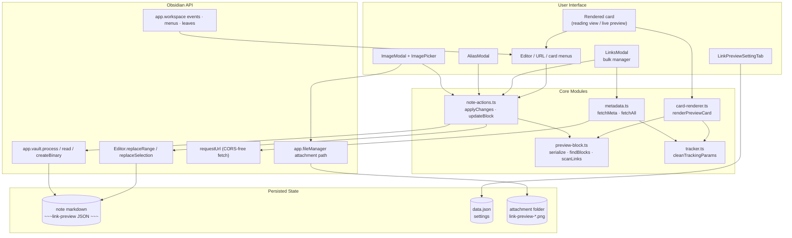
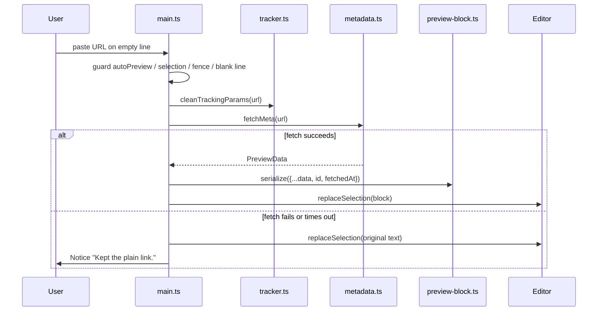
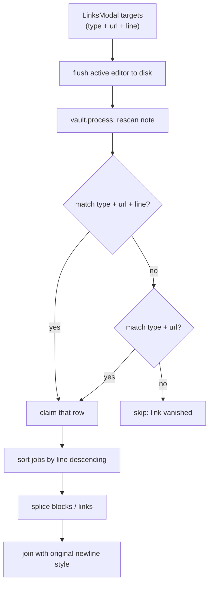

# System Architecture (`ARCHITECTURE.md`)
> **1-Line Summary:** Plain-English map of how the plugin's note format, metadata pipeline, editor writes, and rendering fit together, plus the checks and recipes needed to change it safely.

## 1. High-Level Visual System Map


## 2. Tech Stack & Why We Chose It
* **Language:** TypeScript 5.x, `strict` with `noUncheckedIndexedAccess`, compiled by esbuild into a CommonJS `main.js`.
* **Host:** Obsidian plugin API, `minAppVersion` 1.6.0, desktop and mobile.
* **Networking:** `requestUrl` from the Obsidian API instead of `fetch`, because it bypasses browser CORS restrictions on third-party pages.
* **Parsing:** `DOMParser` on the returned HTML. A full DOM parser is already available in the renderer and is enough for `<meta>` and `<link>` lookups.
* **Storage:** No storage layer. The card is text inside the note; only preferences live in `data.json`.

## 3. Module Responsibilities
### [MODULE: Entry-And-Lifecycle] | Aliases: main.ts, onload, commands, ribbon, public API
> **1-Line Summary:** `main.ts` owns plugin startup, settings migration, host events, menus, image plumbing, and the public API other plugins call.
* **Owns:** `LinkPreviewCard` lifecycle, `onPaste`, `onEditorMenu`, `onUrlMenu`, `showMenu`, `copyUrl`, `refresh`, `revert`, `resolveImage`, `saveImageBlob`, `openVaultImageChooser`.
* **Must not:** parse blocks or build card DOM itself; that belongs to `preview-block.ts` and `card-renderer.ts`.
* **Code Anchors (Grep Targets):** `src/main.ts` -> `onload`, `applyThemePreferences`, `openVaultImageChooser`

### [MODULE: Block-Codec-And-Scanner] | Aliases: preview-block.ts, serialize, findBlocks, scanLinks
> **1-Line Summary:** Converts `PreviewData` to and from the fence format and finds previews, whole-line links, and inline URLs in note text.
* **Owns:** `FENCE_OPEN`/`FENCE_CLOSE` handling, JSON cleanup, block boundaries, link scanning, fence detection.
* **Must not:** fetch anything or mutate files; it is pure text in, text out.
* **Code Anchors (Grep Targets):** `src/preview-block.ts` -> `serialize`, `findBlocks`, `findBlock`, `replaceBlock`, `scanLinks`, `insideFence`

### [MODULE: Tracking-Stripper] | Aliases: tracker.ts, clean URL, host rules, redirect unwrap
> **1-Line Summary:** A single function applies a universal tracker list, host-specific rules, and redirect unwrapping to any URL.
* **Owns:** `UNIVERSAL_TRACKING_PARAMS`, per-host deletions, Google/Facebook redirect resolution, Amazon canonicalization, `parseUrl`, `hostOf`, `rootDomainOf`, `logoLabelOf`.
* **Must not:** rewrite paths or hosts for any site outside the documented rules.
* **Code Anchors (Grep Targets):** `src/tracker.ts` -> `cleanTrackingParams`, `rootDomainOf`, `logoLabelOf`

### [MODULE: Metadata-Fetcher] | Aliases: metadata.ts, OpenGraph, oEmbed, favicon, concurrency
> **1-Line Summary:** Fetches and normalizes page metadata, with a YouTube shortcut and a bounded worker pool for batches.
* **Owns:** `fetchMeta`, `fetchAll`, the 10-second timeout, browser request headers, favicon fallback.
* **Must not:** throw for a single failed URL inside a batch; `fetchAll` deliberately skips failures.
* **Code Anchors (Grep Targets):** `src/metadata.ts` -> `fetchMeta`, `fetchAll`, `withTimeout`

### [MODULE: Note-Actions] | Aliases: note-actions.ts, applyChanges, updateBlock, insertPreview
> **1-Line Summary:** All note mutation lives here, with an editor fast path and a vault fallback for notes that are not open.
* **Owns:** `flushActiveNote`, `getActiveEditorForFile`, `applyChanges`, `cleanTrackersInFile`, `updateBlock`, `revertBlock`, `insertPreview`.
* **Must not:** assume a file is open in a tab, and must not write with raw string replacement when an editor is available.
* **Code Anchors (Grep Targets):** `src/note-actions.ts` -> `applyChanges`, `updateBlock`, `insertPreview`

### [MODULE: Card-Renderer] | Aliases: card-renderer.ts, reading view, placeholder, action row
> **1-Line Summary:** Builds the card DOM from a parsed block, including media, placeholder, site row, title, description, and actions.
* **Owns:** Layout classes, image letterboxing decision, favicon display, action visibility, card click and context-menu wiring.
* **Must not:** edit notes directly; it calls back into `main.ts` methods.
* **Code Anchors (Grep Targets):** `src/card-renderer.ts` -> `renderPreviewCard`, `showPlaceholder`, `iconButton`

### [MODULE: Modals] | Aliases: modals.ts, LinksModal, AliasModal, ImageModal, ImagePicker
> **1-Line Summary:** Four dialogs: bulk link manager, alias editor, image editor, and the fallback fuzzy image picker.
* **Owns:** Selection state, filtering, fetch progress, apply/reload cycle, image paste handling, extension filtering.
* **Must not:** hold stale scan results after an edit; every mutating action reloads the note first.
* **Code Anchors (Grep Targets):** `src/modals.ts` -> `LinksModal.reload`, `LinksModal.run`, `ImageModal.onOpen`

## 4. The Stored Format
```text
~~~link-preview
{"url":"https://example.com","title":"Example","description":"…","image":"https://…","icon":"https://…","siteName":"Example","alias":"","layout":"standard","mediaPosition":"left","imageLocked":true,"id":"lp-…","fetchedAt":1730000000000}
~~~
```
* `serialize()` drops empty strings, `undefined`, and `null`, so added fields stay absent until set.
* `id` is regenerated when a card is created or converted, and is used first when locating a card to edit.
* `imageLocked` means the user chose the image; `refresh` refuses to overwrite it.
* The closing fence is a bare `~~~`, which is why the opener must also be `~~~` and never backticks.

## 5. Data Flow: Paste To Rendered Card
### [FLOW: Paste-Conversion-Pipeline] | Aliases: paste flow, fetch then insert, failure restore
> **1-Line Summary:** Clipboard text is validated, cleaned, fetched, serialized, and inserted at the cursor, with the original text restored on failure.

* Guards are evaluated in this order: setting, `defaultPrevented`, selection, URL shape, blank current line, `insideFence`.
* The pasted card does not set `imageLocked`; it is an automatic fetch and stays refreshable.

## 6. Data Flow: Bulk Conversion
### [FLOW: Bulk-Conversion-Pipeline] | Aliases: link manager flow, bottom-up rewrite, line matching
> **1-Line Summary:** Targeted rows are re-matched against a fresh scan, sorted bottom-up, and spliced so earlier line numbers stay valid.

* Bottom-up ordering is mandatory: replacing a 3-line block changes every later line number.
* CRLF notes keep CRLF; the newline style is detected once per write.

## 7. Data Flow: Editing One Card
### [FLOW: Single-Card-Edit] | Aliases: update block, editor replaceRange, vault fallback
> **1-Line Summary:** Locate the card by `id` then URL, prefer the live editor, and fall back to processing the file on disk.
* **Editor path:** `findBlock(editor.getValue(), data)` then `editor.replaceRange` from the opening-fence line to the end of the closing-fence line. This preserves undo history and cursor position elsewhere.
* **Vault path:** `flushActiveNote`, then `app.vault.process(file, …)` and `replaceBlock`.
* **Why both:** A card can be edited from a hover preview or a background tab where no `MarkdownView` is reachable; conversely, writing the vault while an editor holds unsaved changes can lose them.
* **Code Anchors (Grep Targets):** `src/note-actions.ts` -> `updateBlock`, `revertBlock`, `getActiveEditorForFile`

## 8. Metadata Pipeline Rules
### [METADATA: Fetch-And-Normalize] | Aliases: timeout, headers, favicon fallback, YouTube
> **1-Line Summary:** One request per URL with a browser user agent and a 10-second race; YouTube uses oEmbed plus a deterministic thumbnail.
* **YouTube:** `youtube.com` and `youtu.be` links resolve a video id, fetch `https://www.youtube.com/oembed`, and fall back to the standard scraper if that fails. The image is always `img.youtube.com/vi/<id>/hqdefault.jpg`.
* **General pages:** `og:title` → `twitter:title` → `<title>` → host, each truncated to 300 characters. Description prefers `og:description`, then `twitter:description`, then `description`.
* **Images:** `og:image`, `og:image:secure_url`, `og:image:url`, `twitter:image`, `twitter:image:src`, then `link[rel=image_src]`, resolved against the page URL. Non-HTTP results are discarded.
* **Icons:** the page's `apple-touch-icon` or `icon` link, otherwise `https://www.google.com/s2/favicons?domain=<host>&sz=128`.
* **Batching:** `fetchAll` runs `FETCH_CONCURRENCY` workers over the URL list and reports progress through a callback; failures are omitted from the map.

## 9. Rendering Rules
### [RENDER: Card-DOM-Contract] | Aliases: CSS classes, layout, placeholder, click targets
> **1-Line Summary:** The renderer emits a fixed tree of `lpc-*` classes that `styles.css` styles; changing one side alone breaks the card.
* **Tree:** `.lpc-root` → `.lpc-card` → `.lpc-media` + `.lpc-body` → `.lpc-site-row`, `.lpc-title`, `.lpc-desc`, `.lpc-actions`.
* **State classes:** `is-layout-standard|banner|compact`, `is-media-left|right`, `is-radius-rounded|sharp|pill`, `has-image`, `is-placeholder`, `is-contain`, `is-actions-right|left|space-between|space-evenly`.
* **Image decision:** after load, an image is letterboxed (`is-contain`) when its aspect ratio is under 1.25 or its natural width is under 220px. An error swaps in the placeholder.
* **Click routing:** clicks on `button` or `a` are ignored by the card-level handler, so action buttons never double-trigger the link.
* **Unknown settings:** every render reads `data.* ?? settings.* ?? default`, so old cards gain new defaults without a rewrite.

## 10. Settings & Persistence
### [STATE: Settings-Shape] | Aliases: data.json, merge, visibleActions
> **1-Line Summary:** `data.json` stores only user preferences, merged over `DEFAULT_SETTINGS` on load with a nested merge for `visibleActions`.
* **Migration:** loading merges top-level defaults; `visibleActions` is merged separately so an older partial object keeps new keys. Unknown top-level keys trigger a save that strips them.
* **Never stored in settings:** card content, fetched metadata, or image files.
* **Code Anchors (Grep Targets):** `src/settings.ts` -> `DEFAULT_SETTINGS`, `src/main.ts` -> `onload`

## 11. Build, Verification & Release
```bash
npx tsc -noEmit -skipLibCheck   # types
npm run lint                    # eslint, must be 0 errors
npm run build                   # tsc + esbuild -> main.js
```
* Manual install: copy `main.js`, `manifest.json`, `styles.css` into `<Vault>/.obsidian/plugins/link-preview-card/`.
* `runtime/` is a frozen fallback bundle. Never build into it and never edit it as part of a source change.
* Smoke test after a build: paste a YouTube link, paste a normal article link, open Manage Links and convert both, refresh a card with a locked image, then revert one card.

## 12. Extension Recipes
### [RECIPE: Add-A-Metadata-Source] | Aliases: new site, oEmbed, custom API
> **1-Line Summary:** Add a host branch at the top of `fetchMeta` that returns a complete `PreviewData` and falls through on failure.
1. Match the host with `hostOf(cleanUrl)`.
2. Request the API through `requestUrl` with `throw: false`.
3. Return `{ url, title, description, image, icon, siteName }`; leave fields empty rather than inventing values.
4. If the request fails or the status is not 200, do not return — let the generic scraper run.

### [RECIPE: Add-A-Tracking-Rule] | Aliases: new parameters, host deletion, canonical URL
> **1-Line Summary:** Add universal keys to `UNIVERSAL_TRACKING_PARAMS`, host-specific keys to the matching `if (host.includes(...))` branch.
1. Prefer the universal set for anything that is never meaningful.
2. Use a host branch for keys that are legitimate elsewhere, such as `si` on YouTube but not on blogs.
3. Never delete a key that changes which resource is addressed (`v` on YouTube, `id` on a store).
4. Verify `cleanTrackingParams` returns the input unchanged for malformed URLs.

### [RECIPE: Add-A-Setting] | Aliases: new preference, settings tab, card behavior
> **1-Line Summary:** Extend `LinkPreviewSettings` and `DEFAULT_SETTINGS`, then read it through `settings.x ?? default` in the renderer and add one control.
1. Add the typed field and default.
2. Add a `Setting` in `settings-tab.ts`.
3. If it changes appearance, call `this.plugin.rerenderActivePreviewCards()` after saving.
4. Do not add a migration unless an existing key is renamed or reshaped.
