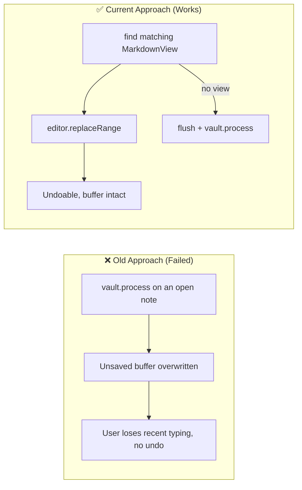

# Architectural Decisions, Pivots & Landmines (`DECISIONS_AND_TRAPS.md`)
> **1-Line Summary:** Why each non-obvious mechanism exists, which broken approach it replaced, and what must never be changed.

## 1. Architectural Decisions & Pivot History

### [DECISION: Markdown-As-The-Database] | Aliases: fence storage, JSON block, portability, sync
> **1-Line Summary:** Cards are stored as a fenced JSON block in the note instead of a plugin database, so they sync and survive uninstall as readable text.
* **Decision Maker:** `[DECIDED BY: HUMAN]` (shape of the live 4.4.0 bundle)
* **Original User Intention:** A preview should travel with the note to another device or vault without a separate export step.
* **Options Considered:**
  * **Option A (Rejected):** A `data.json` map keyed by file path. Moving or renaming a note silently orphans every card, and uninstalling loses all visual content.
  * **Option B (Chosen):** A `~~~link-preview` fence with one JSON line. The note remains self-describing and degrades to text.
* **Code Anchors (Grep Targets):**
  * `src/preview-block.ts` -> `serialize`, `findBlocks`
  * `src/settings.ts` -> `FENCE_OPEN`, `FENCE_CLOSE`

### [DECISION: Tilde-Fences-Not-Backticks] | Aliases: ~~~link-preview, nested fences, code block safety
> **1-Line Summary:** The block uses `~~~` so it can live inside notes and never collides with the far more common backtick fences.
* **Decision Maker:** `[DECIDED BY: HUMAN]`
* **Original User Intention:** Do not fight with existing code blocks, especially when a preview sits next to one.
* **Options Considered:**
  * **Option A (Rejected):** Backtick fence with a `link-preview` info string. Users and other plugins frequently toggle these, and nested backticks break parsing.
  * **Option B (Chosen):** Tilde fence with a bare `~~~` closer.
* **Code Anchors (Grep Targets):**
  * `src/preview-block.ts` -> `findBlocks`, `insideFence`

### [DECISION: Identify-Cards-By-Id-Then-Url] | Aliases: duplicate URLs, findBlock, stable target
> **1-Line Summary:** A card edit locates the block by its stored `id` first and by URL only as a fallback, so two cards for the same URL stay independent.
* **Decision Maker:** `[DECIDED BY: HUMAN]`
* **Original User Intention:** Editing the alias on one card must not rewrite the other card pointing at the same page.
* **Options Considered:**
  * **Option A (Rejected):** Match on URL alone. The first card always won, and a second card became uneditable.
  * **Option B (Chosen):** `data.id` exact match, then URL. New blocks always get an id.
* **Code Anchors (Grep Targets):**
  * `src/preview-block.ts` -> `findBlock`, `makeId`
  * `src/note-actions.ts` -> `updateBlock`

### [DECISION: Editor-First-Writes-With-Vault-Fallback] | Aliases: replaceRange, process, unsaved buffer, background tab
> **1-Line Summary:** Prefer the live editor for card edits, and only process the file on disk when no matching `MarkdownView` exists.
* **Decision Maker:** `[DECIDED BY: HUMAN]`
* **Original User Intention:** Card edits should be undoable with Ctrl+Z and must not discard unsaved typing.
* **Options Considered:**
  * **Option A (Rejected):** Always `vault.process`. When the note was open with unsaved changes, the write raced the buffer and could revert the user's last paragraphs.
  * **Option B (Chosen):** Locate the editor through `getLeavesOfType("markdown")`; use it when present, otherwise flush and process.
* **Visual Pivot Map (What Failed vs. What Works):**

* **Code Anchors (Grep Targets):**
  * `src/note-actions.ts` -> `getActiveEditorForFile`, `flushActiveNote`, `updateBlock`, `revertBlock`

### [DECISION: Bottom-Up-Splicing] | Aliases: bulk conversion, line offsets, reverse order
> **1-Line Summary:** Bulk edits are applied from the last line to the first so replacing one card never shifts the line numbers of pending jobs.
* **Decision Maker:** `[DECIDED BY: HUMAN]`
* **Original User Intention:** Convert ten links at once without corrupting the note.
* **Options Considered:**
  * **Option A (Rejected):** Top-down replacement. Each three-line card insertion pushed later targets down and the wrong lines were replaced.
  * **Option B (Chosen):** Sort jobs by descending line and splice.
* **Code Anchors (Grep Targets):**
  * `src/note-actions.ts` -> `applyChanges`

### [DECISION: Rescan-Before-Bulk-Apply] | Aliases: stale targets, line matching, vault changed
> **1-Line Summary:** The note is rescanned at write time and each target is re-matched by type, URL, and line, then by type and URL.
* **Decision Maker:** `[DECIDED BY: HUMAN]`
* **Original User Intention:** A manager opened before an external edit must not overwrite the wrong region.
* **Options Considered:**
  * **Option A (Rejected):** Trust the line numbers captured when the modal opened.
  * **Option B (Chosen):** Re-derive positions from fresh text and skip vanished links.
* **Code Anchors (Grep Targets):**
  * `src/note-actions.ts` -> `applyChanges`
  * `src/preview-block.ts` -> `scanLinks`

### [DECISION: Strip-Trackers-Before-Storing] | Aliases: privacy by default, clean on paste, clean on fetch
> **1-Line Summary:** Cleaning runs before a URL is fetched, stored, copied, or converted, so tracking IDs never reach the note.
* **Decision Maker:** `[DECIDED BY: HUMAN]`
* **Original User Intention:** Sharing a note should not leak the user's click identifiers.
* **Options Considered:**
  * **Option A (Rejected):** Clean only when the "Clean trackers" command is run. Most notes kept `?si=` and `utm_*` forever.
  * **Option B (Chosen):** `stripTrackers` on by default, applied in paste, insert, convert, copy, and bulk conversion.
* **Code Anchors (Grep Targets):**
  * `src/main.ts` -> `onPaste`, `copyUrl`, `convertLink`
  * `src/note-actions.ts` -> `insertPreview`, `cleanTrackersInFile`

### [DECISION: Image-Lock-On-Manual-Choice] | Aliases: imageLocked, refresh safety, custom thumbnail
> **1-Line Summary:** Setting or clearing an image records `imageLocked`, which makes Refresh skip the remote image while still updating title and description.
* **Decision Maker:** `[DECIDED BY: HUMAN]`
* **Original User Intention:** A chosen screenshot must not be replaced the next time the card refreshes.
* **Options Considered:**
  * **Option A (Rejected):** Treat every image as replaceable. Refreshing discarded the user's screenshot.
  * **Option B (Chosen):** Lock on explicit set/remove; "Automatic" clears the lock and refetches.
* **Code Anchors (Grep Targets):**
  * `src/main.ts` -> `openImageModal`, `refresh`
  * `src/types.ts` -> `PreviewData.imageLocked`

### [DECISION: Bounded-Concurrent-Fetching] | Aliases: three workers, batch progress, rate limits
> **1-Line Summary:** Bulk metadata fetches run at most three URLs at a time and report progress after each completion.
* **Decision Maker:** `[DECIDED BY: HUMAN]`
* **Original User Intention:** Converting a long reference list should not fire fifty requests at once or freeze the modal.
* **Options Considered:**
  * **Option A (Rejected):** `Promise.all` over every URL. Sites rate-limited, some requests timed out together, and the UI showed nothing until the slowest finished.
  * **Option B (Chosen):** A small worker pool with a per-completion callback.
* **Code Anchors (Grep Targets):**
  * `src/metadata.ts` -> `fetchAll`, `FETCH_CONCURRENCY`

### [DECISION: Picker-Delegation-With-Local-Fallback] | Aliases: note-toolbox, openImagePicker, dependency-free
> **1-Line Summary:** Use Note Toolbox's image picker when it exposes one, then its generic picker, and finally the built-in fuzzy file list.
* **Decision Maker:** `[DECIDED BY: HUMAN]`
* **Original User Intention:** Reuse the richer browser when both plugins are installed, but never require it.
* **Options Considered:**
  * **Option A (Rejected):** Hard dependency on Note Toolbox. Users without it could not choose a vault image.
  * **Option B (Chosen):** Feature-detect both APIs and fall back locally.
* **Code Anchors (Grep Targets):**
  * `src/main.ts` -> `openVaultImageChooser`
  * `src/modals.ts` -> `ImagePicker`

### [DECISION: Render-Defaults-Without-Rewriting] | Aliases: layout fallback, old cards, no migration
> **1-Line Summary:** Card fields override settings, but missing fields fall back to current settings at render time, so preference changes apply instantly.
* **Decision Maker:** `[DECIDED BY: HUMAN]`
* **Original User Intention:** Changing the default layout should visibly affect existing cards without a destructive migration.
* **Options Considered:**
  * **Option A (Rejected):** Rewrite every block when a setting changes. That creates huge diffs and breaks sync history.
  * **Option B (Chosen):** `data.layout || settings.cardLayout || "standard"` and the same pattern for media position.
* **Code Anchors (Grep Targets):**
  * `src/card-renderer.ts` -> `renderPreviewCard`

## 2. Landmines & Hard-Won Traps

### [TRAP: CRLF-Line-Endings] | Aliases: Windows notes, newline style, join
> **1-Line Summary:** Every rewrite detects `\r\n` once and rejoins with it; joining with `\n` alone rewrites the entire file on Windows.
* **Why It Bites:** The block lookup is line-based, so the code splits on `/\r?\n/`. Joining with `\n` afterwards makes every line look modified in git.
* **Rule:** Detect `text.includes("\r\n")` immediately before a write and use that separator.
* **Code Anchors (Grep Targets):** `src/note-actions.ts` -> `applyChanges`, `cleanTrackersInFile`, `src/preview-block.ts` -> `replaceBlock`

### [TRAP: Empty-Value-Serialization] | Aliases: undefined fields, JSON cleanup, image removal
> **1-Line Summary:** `serialize` removes empty strings and undefined values, which is how "remove image" clears the field instead of storing `""`.
* **Why It Bites:** Writing `image: ""` would keep a falsy but present key and confuse later comparisons; omitting the key keeps blocks compact.
* **Rule:** Do not replace the filter with a plain `JSON.stringify`; it reintroduces empty fields.
* **Code Anchors (Grep Targets):** `src/preview-block.ts` -> `serialize`, `clean`

### [TRAP: Settings-Nested-Merge] | Aliases: visibleActions, partial settings, lost toggles
> **1-Line Summary:** `visibleActions` needs its own merge; a shallow `Object.assign({}, DEFAULT_SETTINGS, raw)` drops any newly added toggle for existing users.
* **Why It Bites:** Existing `data.json` files contain a six-key object. Adding a seventh action and merging shallowly leaves it `undefined`, and `undefined !== false` shows it, but any code reading `settings.visibleActions.copy` directly is fine only by luck.
* **Rule:** Keep the nested merge and read through `?? DEFAULT_SETTINGS.visibleActions`.
* **Code Anchors (Grep Targets):** `src/main.ts` -> `onload`, `src/card-renderer.ts` -> `vis`

### [TRAP: YAML-Frontmatter-Like-Content] | Aliases: inline URLs, markdown links, scanner false positives
> **1-Line Summary:** Only whole-line URLs become convertible links; URLs embedded in prose remain "inline" and are never bulk-converted.
* **Why It Bites:** The manager would otherwise replace prose sentences with blocks and destroy the note's meaning.
* **Rule:** Keep the `link`/`inline` split in `scanLinks`, and never enable the checkbox for `inline` rows.
* **Code Anchors (Grep Targets):** `src/preview-block.ts` -> `scanLinks`, `src/modals.ts` -> `renderList`

### [TRAP: Card-Click-Versus-Action-Click] | Aliases: event bubbling, double open, button guard
> **1-Line Summary:** The card-level click handler must ignore events originating in a button or anchor, or every action also opens the link.
* **Why It Bites:** Buttons live inside the card; without the guard, copying a URL also opens a browser tab.
* **Rule:** Check `target.closest("button")` and `target.closest("a")` before opening, and keep `stopPropagation()` in the action handler.
* **Code Anchors (Grep Targets):** `src/card-renderer.ts` -> `iconButton`, `card.addEventListener("click")`

### [TRAP: Fence-Detection-For-Paste] | Aliases: inside code block, auto preview, fence toggle
> **1-Line Summary:** Paste conversion is skipped inside any open code fence, detected by toggling on every ` ``` ` or `~~~` line above the cursor.
* **Why It Bites:** Pasting a URL into a code sample must stay literal.
* **Rule:** Keep `insideFence` in sync with both fence styles used by `scanLinks`.
* **Code Anchors (Grep Targets):** `src/preview-block.ts` -> `insideFence`

### [TRAP: Timeout-Versus-Hanging-Request] | Aliases: 10 seconds, withTimeout, frozen modal
> **1-Line Summary:** `requestUrl` has no built-in timeout, so `fetchMeta` races it against `TIMEOUT_MS`; removing that race can hang a paste indefinitely.
* **Why It Bites:** A dead host leaves the "Fetching preview…" notice and an unresolved promise forever.
* **Rule:** Never call `requestUrl` for page metadata without the timeout wrapper.
* **Code Anchors (Grep Targets):** `src/metadata.ts` -> `withTimeout`, `fetchMeta`, `src/settings.ts` -> `TIMEOUT_MS`

### [TRAP: Image-Path-Resolution] | Aliases: wikilink image, vault path, resource URL
> **1-Line Summary:** Stored images may be HTTP URLs, `[[wikilinks]]`, or vault paths; only the last two go through `getFirstLinkpathDest` and `getResourcePath`.
* **Why It Bites:** Assigning a vault path directly to `` yields a broken image, because Obsidian serves vault files through `app://` resource URLs.
* **Rule:** Always resolve through `resolveImage` before rendering.
* **Code Anchors (Grep Targets):** `src/main.ts` -> `resolveImage`, `src/card-renderer.ts` -> `imageSrc`

### [TRAP: Untrusted-JSON-In-Notes] | Aliases: malformed block, invalid url, pre fallback
> **1-Line Summary:** A block whose JSON fails to parse, or whose `url` is not HTTP(S), must render as raw text and never as a card.
* **Why It Bites:** Hand-edited or partially synced notes can contain truncated JSON, and a `javascript:` URL in an anchor is a script injection.
* **Rule:** Validate before rendering; keep `window.open` behind `parseUrl`.
* **Code Anchors (Grep Targets):** `src/card-renderer.ts` -> `renderPreviewCard`, `src/tracker.ts` -> `parseUrl`

### [TRAP: Frozen-Runtime-Bundle] | Aliases: runtime/, fallback, no rebuild
> **1-Line Summary:** `runtime/main.js` is the emergency fallback shipped to users and must never be regenerated or hand-edited by a source change.
* **Why It Bites:** A rebuild overwrites the known-good bundle with an unverified port, removing the user's ability to roll back.
* **Rule:** Build only to the repository root; treat `runtime/` as read-only.
* **Code Anchors (Grep Targets):** `esbuild.config.mjs`, `runtime/main.js`
