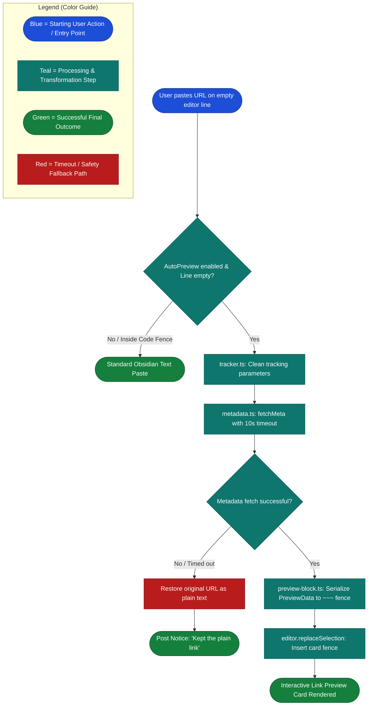
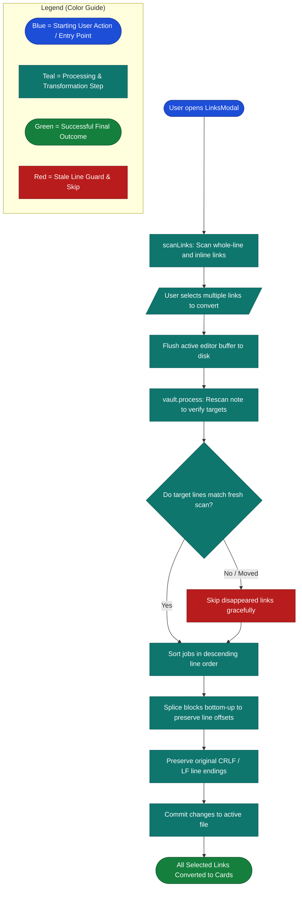

# Visual Feature & Change Log (`VISUAL_LOG.md`)
> **1-Line Summary:** Plain-English, color-coded Obsidian-compatible Mermaid flowcharts explaining how each major flow in Link Preview Card operates end to end.

## Feature & Change Flowcharts

### [VISUAL: Paste-To-Card-Conversion-Flow] | Aliases: paste handler, metadata scraper, card insertion
> **1-Line Summary:** How pasting a URL on an empty note line automatically fetches OpenGraph/oEmbed metadata and renders a preview card.

* **Plain-English Walkthrough:** When a URL is pasted onto an empty line in a note editor, the paste interceptor checks configuration toggles, selection boundaries, and code fences. If valid, tracking parameters are stripped immediately, and page metadata (title, description, thumbnail, favicon) is fetched with a 10-second timeout. Upon success, a formatted `~~~link-preview` block is serialized and replaces the line. If fetching fails or times out, the raw URL is preserved safely without corrupting the note.

* **Code Anchors (Grep Targets):**
  * `src/main.ts` -> `onPaste`, `resolveImage`
  * `src/tracker.ts` -> `cleanTrackingParams`
  * `src/metadata.ts` -> `fetchMeta`, `withTimeout`
  * `src/preview-block.ts` -> `serialize`

---

### [VISUAL: Bulk-Link-Scan-And-Conversion-Flow] | Aliases: links modal, bulk converter, bottom up splicing
> **1-Line Summary:** How the Links Modal scans notes for raw links and converts them into card blocks in reverse line order.

* **Plain-English Walkthrough:** When the user opens the Link Manager modal, the note is scanned for raw whole-line URLs and existing preview cards. The user selects links to convert. Before applying, active editor changes are flushed to disk, targeted rows are re-scanned to ensure lines haven't moved, and replacements are sorted in descending line order (bottom-up) so line offsets remain consistent during text splicing.

* **Code Anchors (Grep Targets):**
  * `src/modals.ts` -> `LinksModal.run`, `LinksModal.reload`
  * `src/note-actions.ts` -> `applyChanges`
  * `src/preview-block.ts` -> `replaceBlock`
